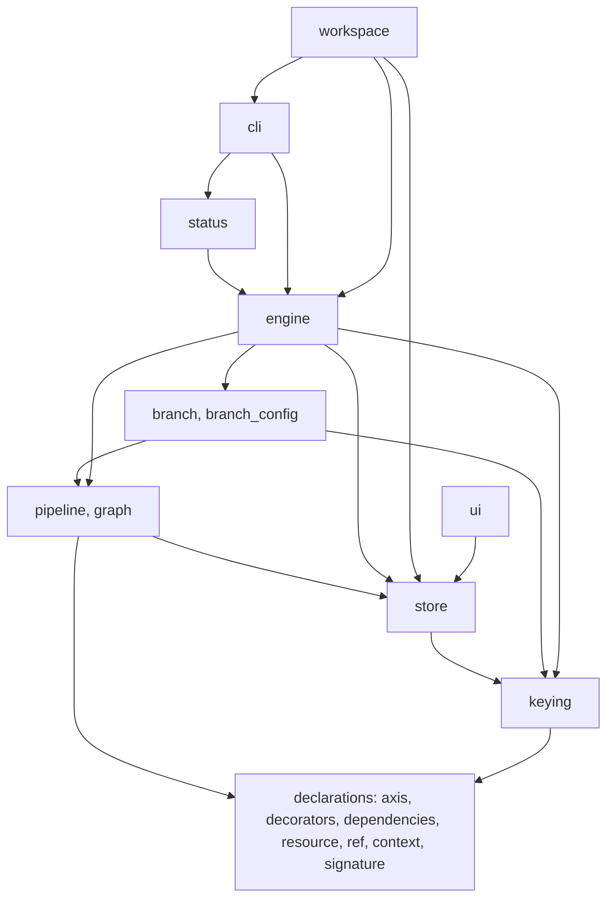

# varve Architecture

This document describes how varve is built: package boundaries, the store, the execution lifecycle, keying, cross-pipeline references, workspace orchestration, and the web UI. Author-facing behavior is specified in [GUIDE.md](GUIDE.md).

## Package layout

```text
src/varve/
├── __init__.py          # public surface: Axis, Ctx, Dependencies, Pipeline, Ref, Resource, stage
├── axis.py              # Axis (static values | dynamic resolver | Axis.files), AxisDomain, canonical ids, Cell
├── decorators.py        # @stage, StageSpec, PublishEntry, coordinate selector parsing
├── dependencies.py      # Dependencies (+ glob/stat), PathSet, Glob, DepCtx, merging
├── resource.py          # Resource, RunCtx
├── ref.py               # Ref (declaration; resolve() lazily uses workspace.refs)
├── pipeline.py          # Pipeline base class: declarations, roots, graph(), cli()
├── context.py           # Ctx and the CtxSink protocol
├── signature.py         # parameter-name binding of stage methods and resolvers
├── graph.py             # StageGraph/StageNode, validation, unit expansion, alignment, publish targets
├── branch.py            # varve.yaml parsing, branch name validation
├── branch_config.py     # branch resolution: Config construction, temporary branches, slice/sample
├── selector.py          # pipeline selector derivation and suffix matching
├── status.py            # view models for status/plan/inspect
├── style.py, log.py     # Rich theme, status styles, CLI logging
├── keying/
│   ├── config_access.py # recording Config proxies, access projection
│   ├── fingerprint.py   # canonical JSON, file walking, content/stat digests, stat cache, artifact manifests
│   ├── source.py        # single-file symbol closure, whole-file fallback, declared sources
│   └── keys.py          # 5-segment input_key, segment reasons, source-match rule
├── store/
│   ├── db.py            # SQLite schema, connections, schema checks, transactions
│   ├── repo.py          # typed row dataclasses and queries
│   ├── layout.py        # metadata, managed, staging, and publish paths; storage root resolution
│   └── lock.py          # fcntl pipeline and branch locks
├── engine/
│   ├── session.py       # one command's pipeline, branch, Config, Args, roots, store, caches
│   ├── probe.py         # stage evaluation: expansion, resolvers, keys, decisions, orphans
│   ├── run.py           # Runner: locking, recovery, stage loop, bookkeeping
│   ├── scheduler.py     # sliding window with exclusive and max_failures
│   ├── backends.py      # inline, thread, async, and spawn process-pool execution
│   ├── unit.py          # unit lifecycle: Ctx, call, produces check, read-only finalize, promote
│   ├── commit.py        # unit rows and cross-branch hardlink reuse
│   ├── writer.py        # batched store writes
│   ├── resources.py     # preflight and scoped sessions
│   ├── publish.py       # hardlink publishing
│   ├── capture.py       # per-unit stdout/stderr routing and fd redirection
│   ├── events.py, tui.py# event bus, live display, plain reporter, progress sinks
│   ├── housekeeping.py  # run ids, git state, startup recovery, log rotation
│   ├── clean.py         # clean planning and execution
│   ├── refs.py          # RefResolver protocol, RefBinding, RefInfo, NoRefResolver
│   └── service.py       # in-process services: run/probe/inspect/reuse/clean
├── cli/                 # generated pipeline CLI (app.py, argmap.py, render.py) and arguments/commands shared with `varve` (common.py)
├── workspace/           # varve.toml, VARVE_ROOT_BASE, discovery, Ref resolution, macro runs, top-level CLI
└── ui/                  # optional varve[ui] web UI: discovery, SQL queries, Starlette app, static assets
```

## Public surface

`varve.__all__` is exactly `Axis, Ctx, Dependencies, Pipeline, Ref, Resource, stage`. `import varve` loads the declaration modules (`axis`, `decorators`, `dependencies`, `resource`, `ref`, `pipeline`, `context`, `selector`) and nothing from `engine`, `cli`, `workspace`, or `ui`; `Pipeline.cli()`, `Pipeline.graph()`, and `Ref.resolve()` import their modules lazily. Everything else, including `varve.engine` services, is internal and may change between minor releases.

## Dependency direction



- Declaration modules depend only on each other. `graph` depends on declarations and on `store.layout` for unit paths.
- `keying` and `store` never import `engine`. `store.repo` uses `keying` types for stat-cache and file-set rows.
- `engine` is the only layer that writes stores and managed directories. It depends on `workspace.config` for `WorkspaceSettings`, and imports `workspace.refs.WorkspaceRefResolver` lazily as the default Ref resolver; it otherwise reaches other pipelines only through the `RefResolver` protocol in `engine.refs`.
- `cli` parses argv and renders; it calls `engine.service` functions, which take a Pipeline class and keyword options and never parse argv. The top-level `varve` command calls the same services and reuses the generated CLI's renderers, argument definitions, command bodies, and error reporting (`cli.common`, which imports the engine only inside its functions).
- `workspace.discovery` reuses `ui.discovery.discover_state_dbs`, which has no web dependencies. `ui.app` imports Starlette and Uvicorn on first access; nothing else imports them.

## On-disk layout

```text
<root>/.varve/state.db (+ -wal, -shm)
<root>/.varve/lock                              # pipeline lock
<root>/.varve/locks/<branch>.lock               # branch lock
<root>/.varve/logs/<run_id>/<stage>/<unit>.log  # captured unit output (only units that wrote any); process.log while the TUI runs
<storage_root>/.internal/<branch>/<stage>/<unit_relpath>/   # managed, read-only unit directories
<storage_root>/.staging/<run_id>/<stage>/<unit_hash>/       # unit scratch during a run
<publish_root>/<branch>/                        # published files of persistent branches
<publish_root>/<branch>/.varve-published/<stage>.json  # files published by the stage's glob entries
<publish_root>/.tmp/<branch>/                   # published files of temporary branches
```

`unit_key` is `"a=x,b=y"` in `foreach` order (`""` without axes; `store.layout.parse_unit_key` splits it back into pairs); `unit_relpath` is `a=x/b=y` with unsafe characters percent-encoded; `unit_hash` is the first 16 hex digits of SHA-256 of `unit_key`. Roots are resolved by `engine.session.resolve_roots`: explicit `--root`, else `VARVE_ROOT_BASE/<pipeline_name>` (which also forces all storages and the publish root below that root), else `Pipeline.default_root(main Config)`. Storage roots combine `Pipeline.storage_roots(config)`, `varve.toml` `[storage]` bases (`<base>/<pipeline_name>`), and `default = <root>/out`; paths are made absolute without resolving symlinks.

## Store

Each pipeline root has one SQLite database, opened with WAL, `synchronous=NORMAL`, `busy_timeout=5000`, and foreign keys on. Read-only opens use a `mode=ro` URI and never create files. A writable open takes a `state.db.init-lock` flock before the file can exist and holds it while it switches to WAL and creates the schema; a read-only open that finds a blank file waits for that lock (shared) and looks again, so readers racing the first run never report a half-created store as foreign. The schema is created on first writable open; a database without `meta`, or with a different `schema_version`, raises `SchemaError`.

| Table | Key | Content |
| --- | --- | --- |
| `meta` | `key` | `schema_version`, `pipeline_name`, `module`, `qualname`, `root`, `graph_json` |
| `storages` | `storage_name` | absolute root path per storage, shared by all branches; recorded at the first run, checked at every later run |
| `branches` | `branch_id` (the branch name) | `is_temp`, `manual`, Config snapshot, active axes snapshot per axis (`[ids]`, `{"sample": n, "seed": s}`, or `{"ids": [ids], "sample": n, "seed": s}` when a sample is drawn from restricted ids) |
| `runs` | `run_id` | branch, start/end, status, argv, git commit and dirty flag, wall time, host (inserted lazily only when a run executes or links units; `total_wall_ms` is recorded only when units execute) |
| `stage_runs` | `(run_id, stage_name)` | status, executed/hit/failed/total units, workers, wall time, unit p50/p95/max, peak RSS, metric sums (recorded only for stages with units to execute) |
| `file_sets` | `fileset_hash` | file lists of inputs with more than 32 files, content-addressed |
| `key_parts` | `part_key` (`<segment>:<segment hash>`) | key-component summaries longer than 128 bytes of JSON, stored once per segment hash |
| `sources` | `source_fp` | `source_detail_json` (file, mode, fallback reason, symbol hashes), stored once per fingerprint |
| `units` | `(branch_id, stage_name, unit_key)` | storage, `input_key`, `key_components_json`, `config_access_json`, `source_fp`, `reused_source_fp`, status, artifact relpath/fp/manifest/files/bytes, metrics, duration, peak RSS, error type/summary/traceback, `last_run_id`, `linked_from`; indexed by `(stage_name, status)` |
| `stat_cache` | `norm_path` (`WITHOUT ROWID`) | inode, size, `mtime_ns`, content hash, AST hash |

`store.repo` hides the split: `key_components_json` keeps every segment's hash, and a summary either inline or, when long, in `key_parts` under `<segment>:<hash>` (every summary is a function of its segment hash, so equal hashes share one row); reads join `sources` and expand the parts back, so `UnitRow.key_components` and `source_detail` look the same as before. `Repo.collect_garbage` deletes `key_parts`, `sources`, and `file_sets` rows no unit references; it runs after every run that executed or linked units and after every `clean`. Orphan `clean` also drops stat-cache rows whose file is gone or changed.

`graph_json` is a zero-import description of the logical graph, written at every run and `reuse`: per stage its dependencies with kind (`data` for injected, `needs`, `resolver`), Ref edges, axes with kind (`static`/`dynamic`; static axes also list their declared `ids` in order), storage, `produces`, publish entries, version, static worker count, and whether it is async; plus every Ref's attribute, target, stage, branches, selector, and `align_by`. The web UI and Ref resolution read it through `store.db.load_graph`.

Invariants:

- A `units` row with status `ok` points to a complete, read-only directory at `storages[storage_name] / artifact_relpath` (the `produces` file for a single-file stage, else the unit directory), whose files match `artifact_manifest_json` (`[relpath, size, mtime_ns, sha256]`). The probe verifies that the unit directory is a real directory (not a symlink) and the manifest by stat (or content with `--rehash`) before calling a unit a hit.
- A unit directory is renamed into place before its `ok` row is committed. A unit that already has a row gets its `running` row committed before its body starts (the scheduler calls `Writer.flush_running` after submitting), so a hard kill leaves it probing as `interrupted`. A unit without a row (`new`) gets its `running` row with the next batched write: if the process dies first, it still probes as `new` and reruns. Before any promotion replaces an existing directory, `Writer.before_promote` commits every pending `running` row, so recovery can always find an `.old-*` backup next to a final directory. A crash between promotion and the `ok` commit leaves a directory with a `running` row, or no row for a new unit, and either is overwritten by the rerun.
- Cross-branch linking verifies the candidate's manifest by stat before and after hardlinking it into staging: the other branch may replace or clean its unit directory concurrently, and since links share inodes, the second check catches any file that changed in between; the unit is executed instead. With a single branch in the store the cross-branch lookup is skipped; otherwise one query per stage indexes the other branches' `ok` rows by `(unit_key, input_key)`, and each prefiltered candidate is reloaded and rechecked in full before linking.
- Storage roots do not depend on the branch: a run whose computed root for a storage differs from the recorded one fails with `StorageRootError`, and `clean` deletes under the recorded roots, so `artifact_relpath` of every branch stays valid.
- `input_key` never contains source code; `source_fp` and `reused_source_fp` are separate columns compared by the source-match rule.
- Key material contains no absolute paths: inputs contribute paths relative to their declared roots, and input summaries record only how many roots an input declared (`root_count`); upstream entries are artifact fingerprints.
- Writers hold the pipeline lock (shared for `run`, `reuse`, branch `clean`; exclusive for whole, storage, and orphan `clean`) and, for branch-scoped writes, the branch lock exclusively. Locks are non-blocking `flock`s on files that are never unlinked.
- During a run, unit rows, file sets, and stat-cache rows are written in one transaction per ~75 ms window (`engine.writer`); a probe reads one stage's rows with one `SELECT`.

## Execution lifecycle

`engine.service.run_pipeline` opens a writable `Session` (`engine.session.open_session`): it builds the graph, loads `WorkspaceSettings` (`varve.toml` plus `VARVE_ROOT_BASE`), creates the default `WorkspaceRefResolver`, resolves the branch (`branch_config.resolve_branch`: `varve.yaml`, stored temporary branches, `--override`/`--temp`/`--slice`/`--sample`), resolves roots, validates storage names, opens the store, loads the stat cache, and computes static axis domains (branch `axes:` and samples applied). A `Runner` then:

1. Takes the pipeline lock (shared) and the branch lock, checks the storage roots against the recorded ones, and writes `meta`, `storages`, and the `branches` row. The `runs` row (status `running`) is inserted lazily only on the first unit execution or cross-branch link, so all-hit runs leave no run record behind.
2. Runs startup recovery for this branch (`housekeeping.recover`).
3. Installs the SIGINT handler and drives the stages in an asyncio loop. The handler only sets a stop flag; the main loop publishes the notice, so it is delayed while an inline unit blocks the loop.
4. For each needed stage in topological order (selected stages plus their ancestors):
   - If a dependency did not complete, finishes the stage as `skipped` (selected dependency) or `blocked` (unselected dependency).
   - Evaluates the stage (`StageEvaluator.evaluate`, below). Unselected ancestors are only evaluated, so their hits become available to selected stages.
   - Marks orphaned rows, collects hits, and tries cross-branch links for the other units (`Committer.link`, which lazily inserts the `runs` row before writing staging or unit rows).
   - Resolves `workers` and the backend. When the stage has units to execute (`to_run` is non-empty), lazily inserts the `runs` row, writes a `stage_runs` row with status `running`, and builds a `ResourceTable` that indexes the distinct `Resource` objects of the units to run (sessions are keyed by object identity, not name; each job carries `name -> index`). Preflights pending resources (once per object per run) and opens stage-scope sessions, both with a recording `RunCtx.config` whose reads are kept per resource. Installs stdout/stderr routing proxies when capturing an in-process stage (TUI on or `workers > 1`). Starts the backend: process pools get a `WorkerSetup` with the pipeline locator, Config, Args, picklable shared sessions and their Config reads, the distinct cells with their resource indices, `worker_env`, and a progress queue; the pool spawns workers with `worker_env` set and SIGINT blocked, so both hold from interpreter start. Stages with no units to execute (all hits or all linked) skip backend startup and write no `stage_runs` row.
   - Feeds units through `scheduler.run_window`. `on_start` writes a `running` row keyed with the probe's key; each completed unit is committed (`Committer.commit_ok`: merge the unit's Config reads with those of its resources' `preflight`/`open` and the previous access set, compute the final key, promote, write the `ok` row) or recorded as `failed` with error details. Any exception while committing is recorded as a unit failure.
   - Publishes when every unit is available (templated targets that collide after expansion, and files of glob or directory targets that two units or entries of the stage place at the same path, fail the stage here), then updates the `stage_runs` row (status, counts, percentiles, peak RSS, metric sums) when one was recorded.
5. Flushes the writer, removes this run's staging directories, finishes the `runs` row if one was inserted (`ok`, `failed`, or `interrupted`; `failed` on an unexpected exception; `total_wall_ms` is recorded only when at least one unit executed), collects unreferenced store rows when any unit executed or linked, releases the locks, and rotates logs (the 20 newest runs are kept, plus every run still recorded as `running`, since other branches may be writing theirs).

Unit execution (`engine.unit.execute` / `execute_async`) runs wherever the backend runs it: create the staging directory, route output to the unit log if capturing (the file is created on the first write, and a process worker's empty log is removed), open unit-scope resources, build `Ctx` with a recording Config proxy, call the stage method with injected arguments, require `None`, check `produces`, hash every file and chmod it to `0444` in the same walk (`artifact_fingerprint`). It returns a picklable `UnitOutcome` (metrics, config access, artifact manifest, error fields, peak RSS for process workers). Promotion and the store commit always happen in the main process.

The scheduler keeps up to `workers` tasks in flight and refills in completion order. An exclusive unit starts only on an empty window and blocks further submissions while it runs; the queue order is kept. A stop request (first Ctrl-C, `max_failures` reached, or a broken process pool) stops submissions and awaits active units. A second Ctrl-C raises `KeyboardInterrupt`, which cancels tasks and terminates process workers.

Events (`RunStarted`, `StagePlanned`, `UnitStarted`, `UnitProgress`, `UnitFinished`, `StageFinished`, `RunFinished`, `Notice`) go through an `EventBus` to either the `rich.Live` display or the plain reporter (`varve` logger on stderr), and to an optional `on_event` callback. Process workers send progress events through a multiprocessing queue pumped by a thread in the main process.

## Probe and decisions

`engine.probe.probe(session, stages)` is the read-only path used by `status`, `plan`, `inspect`, and `reuse`; `run` uses the same `StageEvaluator`. Stages are evaluated in topological order, each against the `StageState` of its dependencies: the expanded units, the available artifacts (`unit_key -> (artifact_fp, path)`; hits during a probe, committed units during a run), whether the stage is complete, and which root upstream it awaits.

`StageEvaluator.evaluate(node, states)`:

1. **Awaiting.** If a dependency is awaiting, or a dependency read by one of the stage's resolvers is not complete, the stage is `awaiting` and is not expanded.
2. **Domains.** For each dynamic-axis request (one per combination of the static axes its resolver names), bind the resolver's parameters (`DepCtx`, static values, aligned upstream artifacts, Ref bindings), call it (an `Axis.files` axis is bound by `graph` to its upstream stage's static axes and the upstream itself; `probe.match_files` globs the aligned upstream unit directory, stripping a single-file `produces` from the artifact path), normalize the result to an `AxisDomain`, memoize it per command by `(axis, cell ids, upstream fingerprints)`, and remember the full domain for orphan detection. Then apply branch active ids and samples.
3. **Expansion and alignment.** `graph.expand_stage` produces units in `foreach` product order; `graph.align_units` matches them with each upstream's units through hash indexes on shared axis ids; the session's `RefResolver` returns one `RefBinding` per unit for each keyed Ref.
4. **Cells.** For each distinct cell (or once per stage when no `resources`/`depends` declaration, and no `depends` of a static resource, is callable), resolve resources and merged dependencies, fingerprint inputs, hash values, and compute the source fingerprint (cached per stage and declared sources).
5. **Keys.** For each unit, assemble segment hashes incrementally: the Config hash projected on the stored row's `config_access_json` (memoized per access set), upstream entries, cell input and value hashes extended by dynamic-axis paths and values, and the version hash (`version` plus the normalized `produces`). NaN or Infinity in values is an evaluation error of the stage. If some upstream unit is unavailable, the key is not computable (`upstream-pending`).
6. **Decision.** Apply the rule in the order `forced`, `new`, `interrupted`, `upstream-pending`, key change, `source-changed`, `failed`, artifact check, `hit` (see the GUIDE). For key changes, the stored `key_components_json` of the stage is loaded once, and the reasons are the changed segments, followed by `source-changed` when the source also changed; all reasons are kept on the unit plan.
7. **Orphans** (run only): stored rows whose axis names differ from the stage's `foreach`, whose static id is no longer declared, or whose static coordinates are active but whose dynamic id is absent from the full resolved domain. Rows only outside the branch's active subset are kept.

Resolver memoization and file hashing go through command-scoped caches on the session: `FingerprintSession` memoizes walks, file hashes, the material of each declared root, and whole input digests per command (files are assumed not to change while a command evaluates keys), and `SourceAnalyzer` caches parsed modules, symbol lookups, and per-symbol references. Content hashes and Python AST hashes are also persisted in `stat_cache`, keyed by path and validated by inode, size, and `mtime_ns`; the session loads that table on its first lookup, so commands that hash nothing never read it. `inspect STAGE@AXIS=ID` filters units before their cells are evaluated.

## Keying

`keying.keys.compute_input_key` hashes the five segments (`config`, `upstream`, `inputs`, `values`, `version`) over canonical JSON (sorted keys, no NaN, models dumped, tuples as lists, paths as POSIX strings) and combines the segment hashes into `input_key`. `key_components_json` keeps each segment's hash and a summary: the projected Config and the access list, upstream entries, per-input digest, file count, bytes, root count, and either inline entries or a `file_sets` reference, the values, and the version. The probe's incremental hashing produces identical values.

**Config access.** `keying.config_access.record_config` wraps a pydantic model or dict in a read-only proxy that records top-level field reads into a `ConfigAccess`, or marks the whole Config when a read cannot be attributed. A unit's first key uses the whole Config (`config_access = NULL`). The committed access set is this execution's set plus the reads of its resources' `preflight`/`open` (stage and worker scope: shared by all units using the resource; unit scope: per unit), unioned with the previous row's set when that row was `ok` with the same `source_fp` (reads that happen only on some executions, such as on an in-unit cache miss, are not lost). A `failed` row records no access set (whole Config) and is keyed accordingly. The set is only rewritten when a unit executes, so under `version=` or after `reuse` it keeps the reads of the last execution. Process workers resolve the access set in the child and return it in the `UnitOutcome`. Cross-branch linking recomputes the config hash under the candidate's access set.

**Inputs.** `keying.fingerprint.FingerprintSession` walks declared roots with `os.scandir` (roots may be symlinks; entries below them may not), walks globs with `walk_glob`, which prunes directories no include pattern can reach (or an exclude removes entirely) and rejects only symlinks the glob would select or descend into, and digests each input as `[mode, [[relpath, sha256] | [relpath, size, mtime_ns], ...]]` per root. Artifact fingerprints are always content hashes, computed right after the unit wrote its files.

**Source.** `keying.source.SourceAnalyzer` parses the stage's defining file once per command (keyed by inode, size, `mtime_ns`) into a symbol table: every top-level binding statement under each name it binds, each imported name as its own symbol, and binding-free statements as the preamble. The closure starts at the stage's `FunctionDef` (with decorators, after stripping the `@stage` keywords `workers`, `exclusive`, `max_failures`, `backend`), the class header, every non-method class-body statement except the `Config`/`Args` bindings (a `defaults` dict display or `dict(...)` call loses the same scheduling keys), every dunder method, and module-level statements that assign to the class. It follows member references (`self.`, `cls.`, `ClassName.`, `type(self).`, `self.__class__.`) within the class and module-level names transitively, and skips the top-level `Config`/`Args` classes of the same file, the main guard, and bare constants. Symbol hashes are SHA-256 of `ast.dump(..., include_attributes=False)`. Dynamic lookups, `getattr` with a non-constant name on the instance or class, or a star import switch to a whole-file AST hash. Declared `sources` contribute whole-file AST hashes through the stat cache. `source_fp` is the hash of `{mode, symbols, external}`; `sources.detail_json` stores the file, mode, fallback reason, per-symbol hashes, and external hashes per `source_fp`, which `inspect` diffs.

**Source match.** `keys.source_match` returns `match`, `reused` (equals `reused_source_fp`), `code-modified` (differs, `version` set), or `changed`.

## Cross-pipeline references

The engine resolves Refs only through `engine.refs.RefResolver.bind(name, ref, axes, coords) -> [RefBinding(value, key)]`, called once per stage for the Refs that enter the key and once per resolver request for Refs a resolver reads. `workspace.refs.WorkspaceRefResolver` implements it without importing upstream modules:

1. Locate the upstream store: a class target uses `pipeline_root` of that class; a string target is matched against `varve.toml` entries and stores discovered under the scan root (exact name, then module or entry, then unambiguous dotted suffix).
2. Read `meta`, the branch row (including `active_axes_json`), `storages`, and the stage's `units` from a read-only connection. Keep rows inside the branch's active domain (declared static `ids` from `graph_json` restricted by the active axes, plus explicit dynamic `axes:` lists); ignore orphaned rows, out-of-domain rows, and rows whose key axes do not match the stage's axes; keep `ok` rows with artifacts and remember the status of in-domain rows that are not `ok`. Order the kept units like a foreach product, independent of row order: static axes by their declared `ids`, dynamic axes (whose resolver order is not stored) by id string. Cache the result for the resolver's lifetime (one command).
3. Align by axis name (honoring `align_by` and `selector`), returning a `Path` or an ordered `dict` of paths per coordinate, with `artifact_fp` or `[[unit_key, fp], ...]` as key material; multi-branch Refs wrap both in a dict keyed by branch. A coordinate that would read a `failed` or `running` in-domain unit, or whose 1-to-1 match or fan-in bucket is missing, is an error. Each path gets an existence check.
4. Record a `RefInfo` per upstream read (root, ok unit count, last commit time, git state of the last run) for the Refs table.

Errors are `RefResolutionError` with the upstream command to run. A resolution error aborts a probe and fails the stage during a run.

`Ref.resolve()` reads the same records from outside a pipeline: it builds a `WorkspaceRefResolver` over `settings_for(class)` or `load_workspace()` (cwd) and binds the Ref for one empty coordinate, which is exactly what a stage without axes receives.

## Workspace and macro runs

`workspace.config` parses `varve.toml` (`[workspace] pipelines`, `[storage]`, `[defaults] worker_env`) strictly and reads `VARVE_ROOT_BASE` into `WorkspaceSettings`. `workspace.modules.locate_module` finds registered modules with `PathFinder`, level by level, without executing any package `__init__`; `load_pipeline` imports a module (and, for a package without a pipeline, its `__main__`) only when a command needs the class. `workspace.discovery.discover` merges registered entries with stores found under the scan root, attaching each store to its entry by root, pipeline name, or module, and reads only `meta` and aggregate rows.

`workspace.macro.build_plan` builds `(pipeline, branch)` nodes from targets or registered pipelines and their `varve.yaml` branches, imports each pipeline to read the Refs of its graph (class attributes and inline `needs=Ref(...)`), adds the upstream nodes of every Ref branch recursively, orders nodes with Kahn's algorithm (ties by `varve.toml` index, name, branch index), applies `--only`/`--skip`/`--from`, and routes `--set` values to nodes whose `Args` declare the field (coerced with a pydantic `TypeAdapter`). `run_plan` calls `run_pipeline` for each selected node in order, in the same process, with a fresh `WorkspaceRefResolver` per node so each node sees its upstreams' newly committed records, and stops at the first node that does not end `ok`.

`workspace.cli` is the `varve` entry point. CLI output goes through consoles that go quiet after the first `BrokenPipeError`, so a closed stdout or stderr pipe does not fail a command. `ls` and `ui` only touch discovery and SQL and never import `varve.engine`, `workspace.macro`, or `pydantic_settings`; the other commands import them on demand, import pipelines through the `Workspace` object, and call `engine.service`.

## Web UI

`varve.ui` is a separate layer over store files. `ui.discovery.discover_state_dbs` finds `**/.varve/state.db` without following symlinks, skipping dot-directories, `node_modules`, `__pycache__`, `site-packages`, and storage roots. `ui.queries` holds all SQL: every request opens its own read-only connection (`mode=ro`, schema check, `PRAGMA query_only=ON`, `busy_timeout=2000`), computes counts, pagination, error groups, metric aggregates, and history series in SQL, and closes it. `ui.app` maps six JSON endpoints and the static assets (vanilla JavaScript, SVG, and CSS shipped in the wheel, no build step) with Starlette and serves them with Uvicorn. Missing pipelines, branches, stages, units, or runs are 404, `SchemaError` is 409, a locked database is 503. The UI never writes, never imports user modules, and never takes varve locks; WAL lets it read while a run writes.
